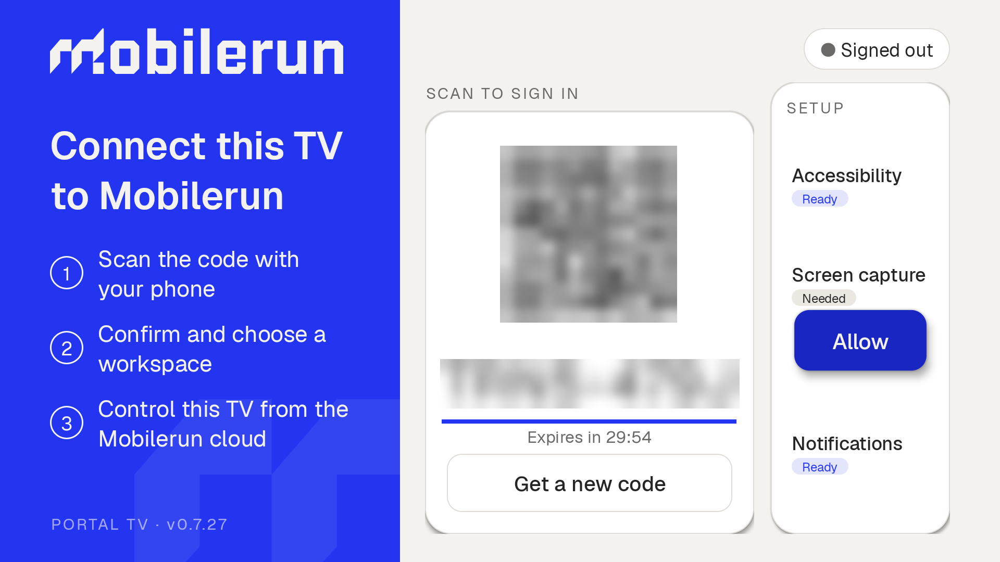
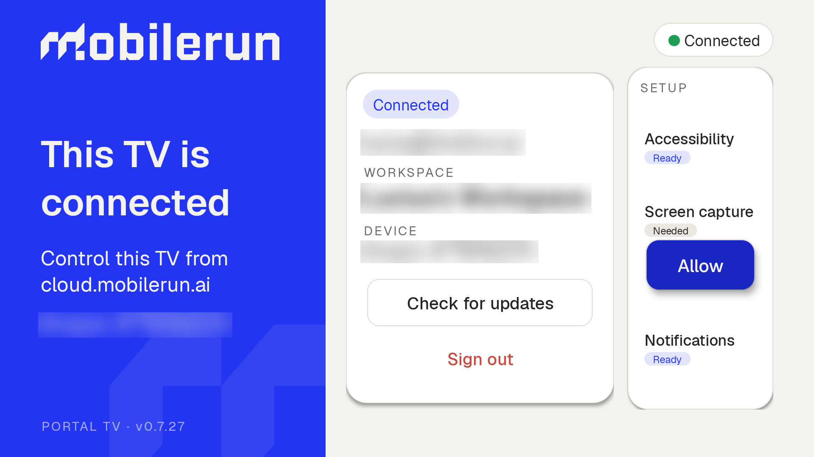

<p align="center">
  <br><br><br>
  <picture>
    <source media="(prefers-color-scheme: dark)" srcset="./static/mobilerun-dark.png">
    <source media="(prefers-color-scheme: light)" srcset="./static/mobilerun.png">
    
  </picture>
  <br><br><br>
</p>

<div align="center">

[](https://github.com/droidrun/mobilerun-portal/stargazers)
[](https://discord.gg/ZZbKEZZkwK)
[](https://docs.droidrun.ai)
[](https://x.com/mobilerun_ai)
[](https://github.com/droidrun/mobilerun-portal/releases)


</div>

## 👁️ Overview
Mobilerun Portal is an Android accessibility service that provides real-time visual feedback and data collection for UI elements on the screen. It creates an interactive overlay that highlights clickable, checkable, editable, scrollable, and focusable elements, making it an invaluable tool for UI testing, automation development, and accessibility assessment.

## ✨ Features

- Interactive overlay that highlights clickable, checkable, editable, scrollable, and focusable elements
- Local control APIs (HTTP socket server, WebSocket JSON-RPC, and ContentProvider)
- Reverse WebSocket connection for cloud control
- WebRTC screen streaming with auto-accept support
- APK install from URLs (including split APKs) with optional auto-accept
- Notification event streaming with per-event toggles

## Portal TV

Portal TV is the Mobilerun Portal build for **Android TV, Google TV, and Fire TV**. It has a landscape interface designed for a TV remote, QR/code sign-in, and cloud screen streaming and control.

### Install

Download `com.mobilerun.portal.tv-<version>.apk` from the [GitHub releases](https://github.com/droidrun/mobilerun-portal/releases), then sideload it onto your TV. For example, with ADB connected to the TV:

```bash
adb install -r "com.mobilerun.portal.tv-<version>.apk"
```

Replace `<version>` with the downloaded release version. Open **Mobilerun Portal TV** from the TV launcher.

### Set up the TV

Enable **Mobilerun Portal TV** in the TV's accessibility settings. Use the setup actions in Portal TV to allow screen capture and grant notification access; notification access is needed to control media playback with media keys.

If Fire OS does not expose the accessibility settings page, this ADB fallback **appends** Portal TV to the enabled services, preserving any services already enabled:

```bash
adb shell '
portal_service="com.mobilerun.portal.tv/com.mobilerun.portal.service.MobilerunAccessibilityService"
enabled_services=$(settings get secure enabled_accessibility_services)
case "$enabled_services" in
  ""|null) enabled_services="$portal_service" ;;
  *)
    case ":$enabled_services:" in
      *":$portal_service:"*) ;;
      *) enabled_services="$enabled_services:$portal_service" ;;
    esac
    ;;
esac
settings put secure enabled_accessibility_services "$enabled_services"
settings put secure accessibility_enabled 1
'
```

If the notification-access page is unavailable, grant access with:

```bash
adb shell cmd notification allow_listener com.mobilerun.portal.tv/com.mobilerun.portal.service.MobilerunNotificationListener
```

### Sign in and control

Scan the QR code with your phone, or open [cloud.mobilerun.ai/device](https://cloud.mobilerun.ai/device) and enter the code shown on the TV. Confirm sign-in and choose a workspace.



Open the TV in [Mobilerun Cloud](https://cloud.mobilerun.ai) to view its screen stream and control it. Use keyboard **arrow keys** to navigate, **Enter** to confirm, and **Esc** to go back.



### Limitations

- DRM-protected apps, including some streaming services, may show a black screen in the stream.
- Fire OS asks for screen-capture consent. With the accessibility service enabled and automatic capture approval enabled, Portal TV accepts the consent dialog automatically for capture requests initiated by Portal TV.

## 🚀 Usage

### ⚙️ Setup
1. Install the app on your Android device
2. Enable the accessibility service in Android Settings → Accessibility → Mobilerun Portal
3. Grant overlay permission when prompted
4. (Optional) Open **Settings** in the app to enable local servers or reverse connection

### 🔐 Auth Token (Local APIs)

Mobilerun Portal generates a local auth token for HTTP and WebSocket access.

- In the app: copy the token from the main screen
- Via ADB:
  ```bash
  adb shell content query --uri content://com.mobilerun.portal/auth_token
  ```

### 🧩 Local APIs

Mobilerun Portal exposes three local interfaces:

- HTTP socket server (default port 8080)
- WebSocket server (default port 8081)
- ContentProvider (ADB commands)

See [Local API](docs/local-api.md) for full details and examples.
See [Triggers and Events](docs/triggers.md) for trigger management methods, event taxonomy, and payload contracts.

### 📡 WebSocket Events

Mobilerun Portal streams notification events over WebSocket when enabled in Settings.

See the [WebSocket Events documentation](docs/websocket-events.md) for setup, permissions, and event formats.
See [Triggers and Events](docs/triggers.md) for the complete `EventType` and `TriggerSource` contract.

### 🌐 Reverse Connection (Cloud)

Enable reverse connection to let the device initiate an outbound WebSocket connection to a host (used by Mobilerun Cloud).

See [Reverse Connection](docs/reverse-connection.md) for configuration details and the streaming protocol.
Trigger JSON-RPC methods are documented in [Triggers and Events](docs/triggers.md).
The operator-facing screen-awake watchdog can also be enabled from **Settings** with **Keep Screen Awake**, or over WebSocket with `screen/keepAwake/set` and `screen/keepAwake/status`.

### 📴 Local No-Accessibility Mode

Mobilerun Portal also has an explicit no-accessibility mode for local HTTP and WebSocket hosting. This is separate from the reverse WebSocket headless fallback: reverse control already exposes a small subset when Accessibility is not ready, while local no-accessibility mode starts a foreground `PortalService` so the local servers can run without the AccessibilityService.

In no-accessibility mode, endpoints that do not need Accessibility can respond, but UI tree extraction, gestures, overlay operations, and screenshots still require the AccessibilityService and will fail normally.

```bash
# Make sure the AccessibilityService is not the owner of the local server ports.
adb shell settings put secure enabled_accessibility_services ""

# Enable no-accessibility local server mode.
adb shell content insert --uri content://com.mobilerun.portal/set_no_a11y_mode --bind enabled:b:true

# Enable local HTTP on the default port 8080, or pass a custom port.
adb shell content insert --uri content://com.mobilerun.portal/toggle_socket_server --bind enabled:b:true
adb shell content insert --uri content://com.mobilerun.portal/toggle_socket_server --bind enabled:b:true --bind port:i:8080

# Enable local WebSocket on the default port 8081, or pass a custom port.
adb shell content insert --uri content://com.mobilerun.portal/toggle_websocket_server --bind enabled:b:true
adb shell content insert --uri content://com.mobilerun.portal/toggle_websocket_server --bind enabled:b:true --bind port:i:8081

# Disable no-accessibility mode and stop the foreground PortalService.
adb shell content insert --uri content://com.mobilerun.portal/set_no_a11y_mode --bind enabled:b:false
```

### 🧭 Transport Matrix

| Capability | ADB ContentProvider | Local HTTP | Local WebSocket | Reverse WebSocket |
| --- | --- | --- | --- | --- |
| Tree/state/version/packages | Yes | Yes | Yes | Yes when Accessibility is ready; headless subset otherwise |
| Keyboard/overlay/config actions | Yes | Yes | Yes | Yes when Accessibility is ready |
| Clipboard get/set | Yes | Yes | Yes | Yes when Mobilerun Keyboard is available |
| Screenshot | No direct endpoint | Yes | Yes | Yes when Accessibility is ready |
| APK install | No | No | Yes | Yes |
| WebRTC streaming + signaling | No | No | No | Yes |
| `files/*` | No | Yes on Android 11+ | Yes on Android 11+ | Yes on Android 11+ |

Android 8 support is a compatibility tier. Core control, screenshots, and reverse streaming are supported on API 26+, but file operations remain Android 11+ only in the current build.

### 💻 ADB Commands (ContentProvider)

All commands use the ContentProvider authority `content://com.mobilerun.portal/`.

#### Query Commands (Reading Data)

```bash
# Test connection (ping)
adb shell content query --uri content://com.mobilerun.portal/ping

# Get app version
adb shell content query --uri content://com.mobilerun.portal/version

# Get accessibility tree as JSON (visible elements with overlay indices)
adb shell content query --uri content://com.mobilerun.portal/a11y_tree

# Get full accessibility tree with ALL properties (complete node info)
adb shell content query --uri content://com.mobilerun.portal/a11y_tree_full

# Get full tree without filtering small elements (< 1% visibility)
adb shell content query --uri 'content://com.mobilerun.portal/a11y_tree_full?filter=false'

# Get phone state as JSON (current app, focused element, keyboard visibility)
adb shell content query --uri content://com.mobilerun.portal/phone_state

# Get combined state (accessibility tree + phone state)
adb shell content query --uri content://com.mobilerun.portal/state

# Get full combined state (full tree + phone state + device context)
adb shell content query --uri content://com.mobilerun.portal/state_full

# Get full state without filtering
adb shell content query --uri 'content://com.mobilerun.portal/state_full?filter=false'

# Get list of installed launchable apps
adb shell content query --uri content://com.mobilerun.portal/packages

# Get local auth token for HTTP/WS access
adb shell content query --uri content://com.mobilerun.portal/auth_token

# Get clipboard text (requires Mobilerun Keyboard to be selected)
adb shell content query --uri content://com.mobilerun.portal/clipboard/get

# Get keep-screen-awake watchdog status
adb shell content query --uri content://com.mobilerun.portal/screen_keep_awake_status

# Get the max number of concurrent stream viewers (limit, min, max)
adb shell content query --uri content://com.mobilerun.portal/stream_session_limit
```

#### Insert Commands (Actions & Configuration)

```bash
# Keyboard text input (base64 encoded, clears field first by default)
adb shell content insert --uri content://com.mobilerun.portal/keyboard/input --bind base64_text:s:"SGVsbG8gV29ybGQ="

# Keyboard text input without clearing the field first
adb shell content insert --uri content://com.mobilerun.portal/keyboard/input --bind base64_text:s:"SGVsbG8=" --bind clear:b:false

# Clear text in focused input field
adb shell content insert --uri content://com.mobilerun.portal/keyboard/clear

# Send key event via keyboard (e.g., Enter key = 66, Backspace = 67)
adb shell content insert --uri content://com.mobilerun.portal/keyboard/key --bind key_code:i:66

# Set clipboard text
adb shell content insert --uri content://com.mobilerun.portal/clipboard/set --bind text:s:"Hello World"
adb shell content insert --uri content://com.mobilerun.portal/clipboard/set --bind text_base64:s:"SGVsbG8gV29ybGQ="

# Set overlay vertical offset (in pixels)
adb shell content insert --uri content://com.mobilerun.portal/overlay_offset --bind offset:i:100

# Toggle overlay visibility (show/hide)
adb shell content insert --uri content://com.mobilerun.portal/overlay_visible --bind visible:b:true
adb shell content insert --uri content://com.mobilerun.portal/overlay_visible --bind visible:b:false

# Configure REST API socket server port (default: 8080)
adb shell content insert --uri content://com.mobilerun.portal/socket_port --bind port:i:8090

# Enable/disable local HTTP socket server (default port: 8080)
adb shell content insert --uri content://com.mobilerun.portal/toggle_socket_server --bind enabled:b:true --bind port:i:8080
adb shell content insert --uri content://com.mobilerun.portal/toggle_socket_server --bind enabled:b:false

# Enable/disable local WebSocket server (default port: 8081)
adb shell content insert --uri content://com.mobilerun.portal/toggle_websocket_server --bind enabled:b:true --bind port:i:8081
adb shell content insert --uri content://com.mobilerun.portal/toggle_websocket_server --bind enabled:b:false

# Enable/disable explicit no-accessibility local server mode
adb shell content insert --uri content://com.mobilerun.portal/set_no_a11y_mode --bind enabled:b:true
adb shell content insert --uri content://com.mobilerun.portal/set_no_a11y_mode --bind enabled:b:false

# Enable or disable the keep-screen-awake watchdog
adb shell content insert --uri content://com.mobilerun.portal/toggle_screen_keep_awake --bind enabled:b:true
adb shell content insert --uri content://com.mobilerun.portal/toggle_screen_keep_awake --bind enabled:b:false

# Set the max number of concurrent stream viewers, the main stream included (1-5, default: 3).
# Applies to new viewers; viewers already connected keep streaming.
adb shell content insert --uri content://com.mobilerun.portal/stream_session_limit --bind limit:i:4

# Configure reverse connection (host URL + optional token/service key)
adb shell content insert --uri content://com.mobilerun.portal/configure_reverse_connection --bind url_base64:s:"d3NzOi8vYXBpLm1vYmlsZXJ1bi5haS92MS9wcm92aWRlcnMvcGVyc29uYWwvam9pbg==" --bind token_base64:s:"WU9VUl9UT0tFTg==" --bind enabled:b:true
adb shell content insert --uri content://com.mobilerun.portal/configure_reverse_connection --bind service_key_base64:s:"WU9VUl9LRVk="

# Toggle production mode UI
adb shell content insert --uri content://com.mobilerun.portal/toggle_production_mode --bind enabled:b:true
```

#### Common Key Codes

| Key | Code | Key | Code |
|-----|------|-----|------|
| Enter | 66 | Backspace | 67 |
| Tab | 61 | Escape | 111 |
| Home | 3 | Back | 4 |
| Up | 19 | Down | 20 |
| Left | 21 | Right | 22 |

### 📤 Data Output
Element data is returned in JSON format through the ContentProvider queries. The response includes a status field and the requested data. All responses follow this structure:

```json
{
  "status": "success",
  "result": "..."
}
```

For error responses:
```json
{
  "status": "error", 
  "error": "Error message"
}
```

## 🔧 Technical Details
- Minimum Android API level: 26 (Android 8.0) for the core compatibility tier
- File operations (`files/*`) require Android 11 or newer in the current build
- Uses Android Accessibility Service API
- Implements custom drawing overlay using Window Manager
- Supports multi-window environments
- Built with Kotlin


## 🔄 Continuous Integration

This project uses GitHub Actions for automated building and releasing.

### 📦 Automated Builds

Every push to the main branch or pull request will trigger the build workflow that:
- Builds the Android app
- Creates the APK
- Uploads the APK as an artifact in the GitHub Actions run

Tag releases (`v*`) build a single signed release APK using the
`DROIDRUN_KEYSTORE_*` GitHub Actions secrets. The published release asset is
named `com.mobilerun.portal-<version>.apk`.
